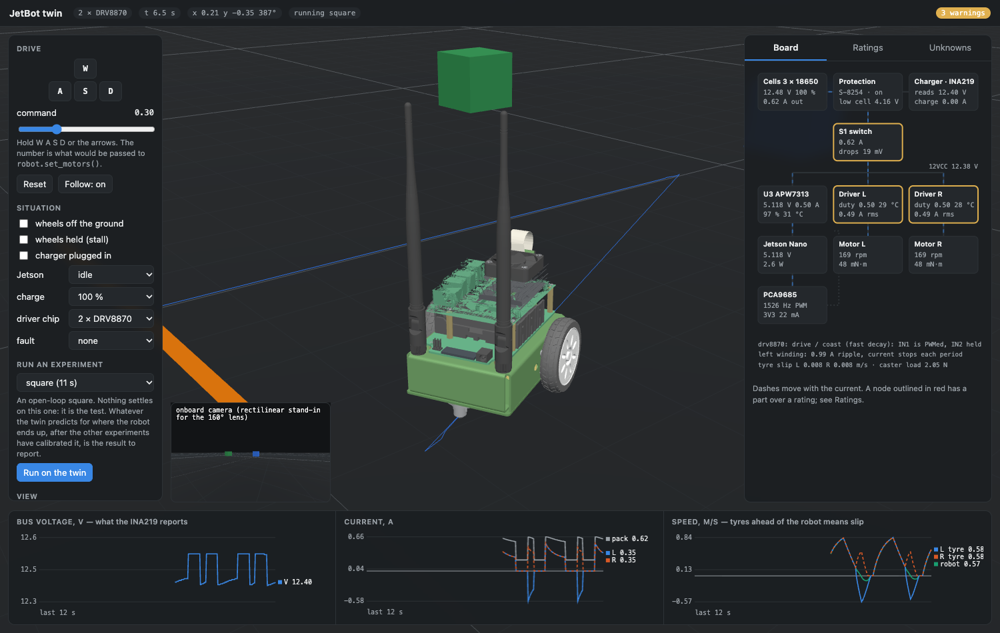
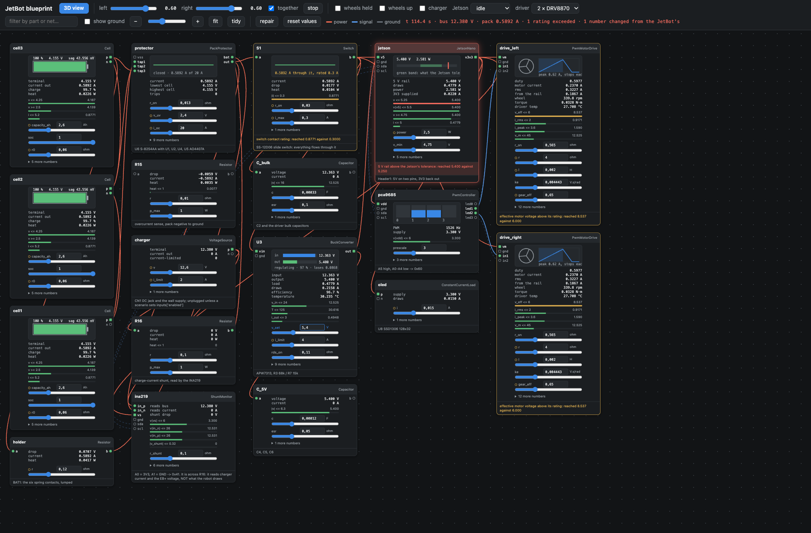

# JetBot twin

A digital twin of the Waveshare JetBot AI Kit (Jetson Nano), built to be
compared with the real robot, and **elecsim**, the code-first electrical
simulation framework it is written on.

```
elecsim/        the framework: describe a circuit in Python, constrain it, simulate it.
                Knows nothing about the JetBot.          -> docs/FRAMEWORK.md
jetbot_twin/    the JetBot: its board as an elecsim design, its dynamics, and the
                tools for comparing the twin with the robot  -> docs/MODEL.md
robot/agent.py  the one file that runs on the real JetBot
web/            the live 3D view
```

## Status

| | |
|---|---|
| Framework | working, 60 tests |
| JetBot circuit | transcribed from Waveshare's schematic |
| JetBot geometry | Waveshare's own CAD, measured and converted |
| Dynamics | working |
| **Compared with the real robot** | **one session, 2026-10-04: ten experiments, from the bench to a held-out square on the floor.** See [docs/RESULTS.md](docs/RESULTS.md), or [report/report.pdf](report/report.pdf) for the whole project |

In one line: the twin predicts steady motion to a few percent (straight-line
distance within 3 %, a two-second spin within 6 %, both predicted before the
run) and does not predict short open-loop turns, which the robot itself does
not repeat.

The motors, the driver chip, the pack and the floor drag have been measured on
this robot. 50 numbers are still estimates, among them the robot's mass.
`python -m jetbot_twin assumptions` lists them.
[docs/VALIDATION.md](docs/VALIDATION.md) is the procedure that replaced the
rest with measurements.

## Setup

```bash
python3 -m venv .venv && source .venv/bin/activate
pip install -e ".[dev]"
pytest                                    # about 30 s
```

Python 3.9 or later. The framework needs only numpy; the comparison tools add
scipy and matplotlib.

## The twin

```bash
python -m jetbot_twin serve               # live 3D twin in the browser
```



Drive it with W A S D. The page shows the robot, the board's power path with
live currents and voltages, every part's rating and how close it is, and the
unmeasured numbers as sliders. Everything on the page is computed by the
Python twin; the browser only draws.

```bash
python -m jetbot_twin info                # the robot as the twin knows it
python -m jetbot_twin check               # the board against every part's rating
python -m jetbot_twin run square          # one experiment, with a figure
python -m jetbot_twin predict             # predictions with uncertainty bands
python -m jetbot_twin export              # URDF and Gazebo SDF
```

Press **B**, or the Blueprint button, for the electrics on their own page:



Every component of the board is a node with its pins, a live instrument and
its numbers. The numbers start as the JetBot's own; change one and the twin
re-solves with it, and any part you have pushed past a rating goes red and
says why. (Above: the 5 V set point raised to 5.4 V, and the Jetson objecting.)
"reset values" puts everything back. The page is drawn from the live circuit,
so a different elecsim design served the same way would draw itself.

From Python it has the same interface as the real robot:

```python
from jetbot_twin.twin import JetBotTwin

twin = JetBotTwin()                       # this robot's board: the TB6612FNG
twin.robot.set_motors(0.5, 0.5)           # as on jetbot.Robot
twin.sleep(2.0)                           # time is yours to advance
print(twin.telemetry())                   # pose, currents, and what the INA219 would read
```

## With the real robot

```bash
python -m jetbot_twin real probe --host jetbot@<ip>
python -m jetbot_twin real run wheels_up_sweep --host jetbot@<ip> --session 2026-10-05
python -m jetbot_twin compare   --session 2026-10-05
python -m jetbot_twin calibrate --session 2026-10-05
python -m jetbot_twin --calibrated compare --session 2026-10-05
```

The same experiment definition runs on both, both produce a log with the same
columns, and `compare` lays one over the other. See
[docs/VALIDATION.md](docs/VALIDATION.md).

## The framework on its own

```bash
python -m elecsim new my_board            # a starter design
python -m elecsim check my_board.py       # rules, ratings, requirements
python -m elecsim check examples/02_your_own_part.py
python -m elecsim fmea jetbot_twin.electrical -s cruise
```

A design is a Python file with a `build()` function. Parts are classes; to add
one you declare its pins and numbers and write its equations.
[docs/FRAMEWORK.md](docs/FRAMEWORK.md) is the guide, and `examples/` has a
minimal design and one that defines its own parts, ratings and rules.

## What the twin has found

### From the schematic and the model, before any measurement

See [docs/ELECTRICAL.md](docs/ELECTRICAL.md). What the robot later said about
each is in italics.

- **The board has footprints for two different motor drivers**, and they PWM
  the motor in different ways. The twin predicted a dead band up to a command
  of about 0.2 with one and almost none with the other, and that one coasts to
  a stop where the other brakes. *This board has the TB6612FNG: no dead band,
  and it brakes. Identified electrically, without opening the robot.*
- **The INA219 measures charger current, not what the robot draws.** The robot
  has no sensor for its own load or motor current.
- **The motors are fed the full 12 V pack.** *They are ordinary 6 V units, so
  a command of 1.0 is twice their rating.*
- **The slide switch named on the schematic is commonly a 0.3 A part**, and
  carries everything. Worth reading the part on the board. *Not yet read.*
- **The Jetson's 5 V rail is safe in every scenario tried.** *Wrong. See
  below.*
- **An open-loop manoeuvre cannot be predicted before calibration.** With the
  motors unmeasured, the band on where a driven square ends covers most of the
  circle. *After calibration it still cannot: see below.*

### From the comparison with the robot

See [docs/RESULTS.md](docs/RESULTS.md).

- **Steady motion is predicted to a few percent.** Straight-line distance to
  within 3 % and a two-second spin to within 6 %, both saved before the run;
  wheel speed across the command range to within 8 % after calibration. The
  wheel's spin-up and braking times (80 against 83 ms, 140 against 162 ms)
  were never fitted.
- **Short open-loop turns are not.** In the held-out square the twin got every
  side to within a few centimetres and the corners wrong by up to 39°. From
  rest the robot turns 13 % further than the twin and repeats itself to about
  ±8°; straight after a side, the same turn is about three times as variable
  (six corners, so a rough figure). Why is not established.
- **The Jetson's 5 V supply falls to 4.5 V under CPU load**, below its 4.75 V
  specification, through about 0.5 Ω that is on no schematic.
  `python -m jetbot_twin --calibrated check` shows the consequence. This rests
  on the Jetson's own reading, not yet confirmed with a multimeter.
- **The pack's resistance roughly doubles as it empties**, and the twin has
  one number for it.
- **The two motors differ by about 2.6 %**, from one straight run. The twin's
  are identical, so it predicts no drift.
- **How long a motor command lasts varied by tens of milliseconds**, because
  it is fourteen I²C writes from Python, and a quarter-turn moved 5° for every
  10 ms. The stock `jetbot` library sends commands the same way.
  [robot/agent.py](robot/agent.py) now holds a 290 ms turn to about 2 ms.

## Where things are

| | |
|---|---|
| [jetbot_twin/hardware.py](jetbot_twin/hardware.py) | **every number, and where it came from. The file you edit** |
| [jetbot_twin/electrical.py](jetbot_twin/electrical.py) | the board, component by component |
| [jetbot_twin/dynamics.py](jetbot_twin/dynamics.py) | tyres, casters, mass |
| [jetbot_twin/twin.py](jetbot_twin/twin.py) | the two stepped together; the `Robot` interface |
| [jetbot_twin/experiments.py](jetbot_twin/experiments.py) | the experiments, shared by twin and robot |
| [jetbot_twin/compare.py](jetbot_twin/compare.py), [calibrate.py](jetbot_twin/calibrate.py) | twin against robot |
| [jetbot_twin/predict.py](jetbot_twin/predict.py) | predictions with uncertainty |
| [robot/agent.py](robot/agent.py) | runs on the JetBot |
| [tools/](tools/) | STEP to GLB, figures, and reading wheel speed, heading and path from video |
| [reference/](reference/) | Waveshare's schematic and CAD |
| [data/real/](data/real/) | logs and hand measurements from the robot |
| [results/](results/) | predictions, the rehearsal, fits, comparisons |
| [report/](report/) | the project report |

## Sources

- Waveshare JetBot AI Kit wiki, schematic and 3D drawing: https://www.waveshare.com/wiki/JetBot_AI_Kit
- `jetbot/motor.py`, NVIDIA-AI-IOT/jetbot: https://github.com/NVIDIA-AI-IOT/jetbot
- Datasheets: TI DRV8870, Toshiba TB6612FNG, NXP PCA9685, TI INA219, Anpec APW7313, AOS AO4407A, ABLIC S-8254A
