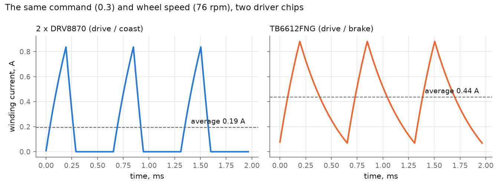
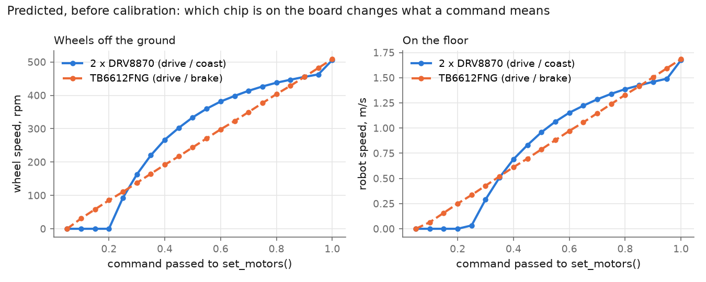

# The JetBot's electronics, as the twin models them

The circuit in [jetbot_twin/electrical.py](../jetbot_twin/electrical.py) is a
transcription of Waveshare's schematic,
[reference/JetBot_schematic.pdf](../reference/JetBot_schematic.pdf) (dated
2020-02-28), using the schematic's own reference designators. Read the two side
by side. Where they disagree, the PDF is right.

```bash
python -m jetbot_twin check              # the board against its ratings
python -m jetbot_twin --board tb6612 check
python -m elecsim show jetbot_twin.electrical    # every component, every net
python -m elecsim fmea jetbot_twin.electrical -s cruise
```

## The power path

```
3 x 18650 ── holder ── U1/U2/U4/U5 ──┬── EB+ ── S1 ── 12VCC ──┬── U3 buck ── 5V ── Jetson Nano
   │                  (AO4407A x4,   │      (slide            │                      │
   R15 10 mΩ           driven by     │       switch)          ├── driver ── motor L  3V3 ──┬── PCA9685
   │                   U6 S-8254AA)  │                        └── driver ── motor R        ├── INA219
  GND                                R16 100 mΩ ← INA219 reads across this                 └── OLED
                                     │
                                  DC jack (charger)
```

| Ref | Part | In the twin | Values from |
|---|---|---|---|
| BAT1 | 3 × 18650 in a holder | three `Cell`s and a contact resistance | **assumed**: the kit ships without cells |
| U6, U1/2/4/5 | S-8254AA and four AO4407A | `PackProtector` | FETs: datasheet. Trip thresholds: **assumed**, the S-8254AA variant is not marked on the schematic |
| R15 | 10 mΩ sense | `Resistor` | schematic |
| R16 | 100 mΩ shunt | `Resistor` | schematic |
| INA219 | at 0x41 | `ShuntMonitor` | schematic (A0 = 3V3, A1 = GND) |
| S1 | SS-12D06 slide switch | `Switch` | rating **assumed**, see below |
| U3 | APW7313 buck, 5.118 V | `BuckConverter` | schematic (R3 68k, R7 15k) and datasheet |
| Header1 | to the Jetson | `JetsonNano` (in `parts.py`) | power draw **assumed** until read off the Jetson's own monitor |
| PCA1 | PCA9685 at 0x60 | `PwmController` | schematic (A5 high) |
| TB1 *or* DRV1, DRV2 | motor driver | `PwmMotorDrive` or `HBridge` | datasheets |
| H1, H2 | motors | inside the drive | **assumed**: Waveshare give only "1:48, 240 RPM" |

## Seven things the schematic says that matter

**1. The board has footprints for two different motor drivers.** One
TB6612FNG (TB1), or two DRV8870 (DRV1, DRV2). Their outputs go to the same
motor connectors, so one or the other is fitted. They are driven from
different PCA9685 channels:

| | PCA9685 channels | What is PWMed |
|---|---|---|
| TB6612FNG | 8–13 (the Adafruit MotorHAT layout) | the PWM pin; direction pins held |
| DRV8870 × 2 | 0–3 | one input pin; the other held low |

This is why `jetbot/motor.py` has two lines commented "required for the
Waveshare JetBot Board only": it writes both sets of channels every time, and
whichever chip is there responds.

**2. The two chips drive the motor in different ways, and it changes what a
command means.** With its PWM pin low, the TB6612FNG shorts the motor (slow
decay). With both inputs low, the DRV8870 turns everything off and the current
dies through the body diodes (fast decay), after which the winding is
disconnected for the rest of the period.



Same command, same wheel speed: 0.19 A average against 0.44 A. The motor's
electrical time constant (assumed 0.5 ms) is about the same as the PWM period
(0.66 ms), so the current has time to reach zero and the coast-mode drive
spends most of each period doing nothing. The consequence for the robot:



On the DRV8870 board the twin predicts nothing happens below a command of
about 0.2, then a steep rise. On the TB6612FNG board it predicts a nearly
straight line from 0.1. **This is a prediction, not a measurement**; where
exactly the dead band ends depends on the motor's inductance and friction,
which are assumed. But the difference in *shape* does not depend on those, and
the wheels-up sweep in [VALIDATION.md](VALIDATION.md) tests it directly.

The chips also differ when the command returns to zero. The software leaves
the TB6612FNG's direction pins set and its PWM pin low, which is a short
brake; it leaves both DRV8870 inputs low, which is a coast. So one board stops
the robot and the other lets it roll.

| Predicted (5–95 % band over the unverified numbers) | 2 × DRV8870 | TB6612FNG |
|---|---|---|
| Lowest command that turns a free wheel | 0.20 – 0.30 | 0.10 |
| Free wheel speed at command 0.3 | 76 – 243 rpm | 111 – 159 rpm |
| Roll-on after a 2 s run at 0.5 | 0.16 – 0.71 m | 0.04 – 0.13 m |
| Bus sag with wheels held at 0.5 | 84 – 288 mV | 302 – 599 mV |

From `python -m jetbot_twin predict`; the full table is in
[results/predictions.txt](../results/predictions.txt). The bands barely overlap,
so any one of these tests identifies the chip.

Which chip you have: look at the board. One 24-pin chip near the motor
connectors is the TB6612FNG; two 8-pin chips are the DRV8870s. Then set
`board` in `hardware.py`.

**3. The INA219 does not measure what the robot draws.** R16 sits between the
DC jack and the battery rail, so the INA219 reads *charger* current (zero
when unplugged) and the rail voltage. The robot has no sensor for its own
load current or its motor current. Everything the twin says about current is
tested indirectly, through the voltage that current costs. The twin's
`ShuntMonitor` is wired the same way, so the twin reports what the robot would
report, not what is true.

**4. The motors see the full pack voltage.** 12VCC goes straight to the driver
supply. If the motors are the usual 6 V "TT" units, a command of 1.0 is twice
their rating. The check flags this as a warning.

**5. Everything flows through S1.** The schematic calls it SS-12D06. The
common part of that name is rated 0.3 A at 50 V DC; some vendors list 2 A.
The twin predicts 0.2 A at idle and over 5 A at full throttle. The check flags
it as a warning rather than a failure because the rating is the uncertain
part: read the switch that is actually on your board.

**6. The 5 V rail is set to 5.118 V**, not 5.0: 0.925 V × (1 + 68k/15k). That
is inside the Jetson's ±5 % and leaves more room below than above.

**7. The PWM frequency is 1526 Hz, not 1600.** The library asks for 1600; the
PCA9685's prescaler can only produce 25 MHz / (4096 × 4). The twin's
`PwmController` does the same arithmetic as the library and arrives at the
same number.

## What the check finds

Six scenarios, from idle to "stalled, Jetson flat out, pack nearly empty".
With the numbers as assumed:

| | idle | cruise (0.3) | full speed | stall | stall, 10 % charge | worst case |
|---|---|---|---|---|---|---|
| 12 V rail, lowest | 12.52 | 12.39 | 10.76 | 10.68 | 8.72 | 8.24 V |
| 5 V rail, lowest | 5.118 | 5.118 | 5.118 | 5.118 | 5.118 | 5.118 V |
| pack current, peak | 0.21 | 0.58 | 5.2 | 5.4 | 4.7 | 5.0 A |

(DRV8870 board. Run the check for the full list and for the other chip.)

- **The Jetson is safe in every scenario.** Even at 8.2 V the buck holds 5.118 V
  with room to spare; it does not reach dropout until about 5.6 V.
- **A stall is over the DRV8870's continuous rating** (2.4 A against an assumed
  2 A), and on the TB6612FNG board it is twice the 1.2 A rating. Neither chip
  is destroyed, they have thermal shutdown, but a JetBot pushed against a wall
  at full command will cut out.
- **Full throttle pulls about 2C from the cells** if they are 2.6 Ah.

## What is not modelled

- The S-8254AA's cell balancing, and U7/U9, whose function on the schematic I
  could not determine with confidence.
- The I²C bus as anything but connectivity.
- Decoupling capacitors, except lumped on the two rails.
- The Jetson's internals: it is a power draw and a 3.3 V source.
- Temperature feeding back into resistance.
