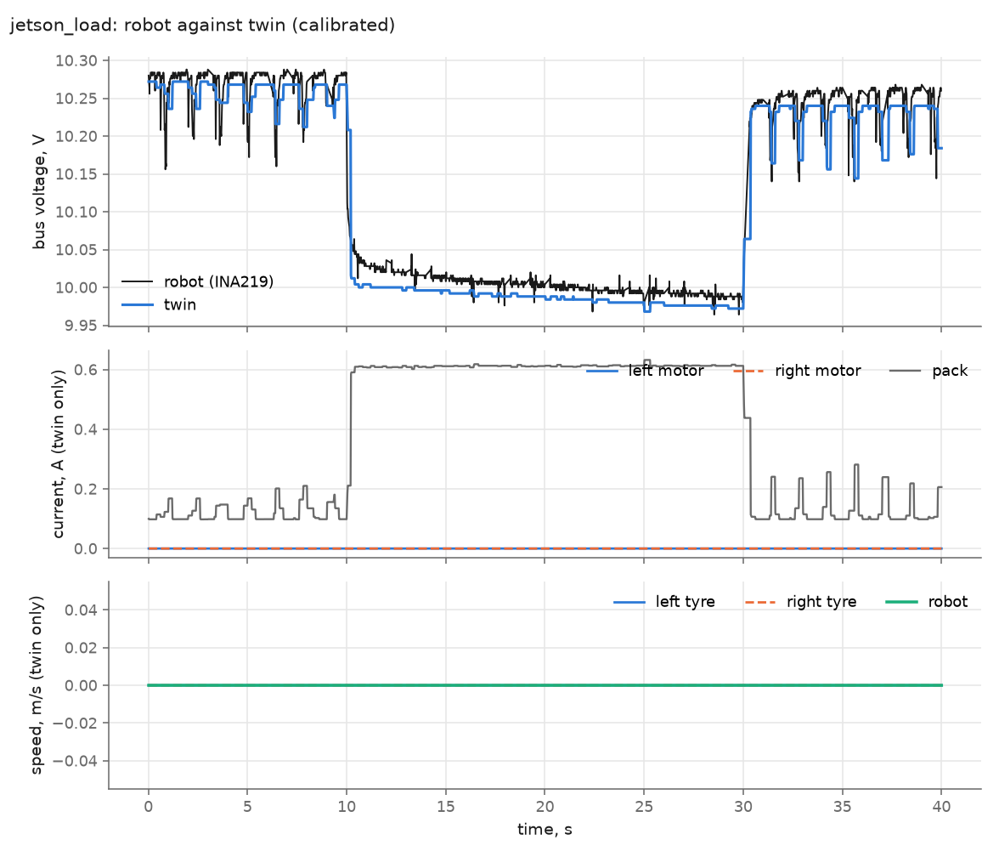
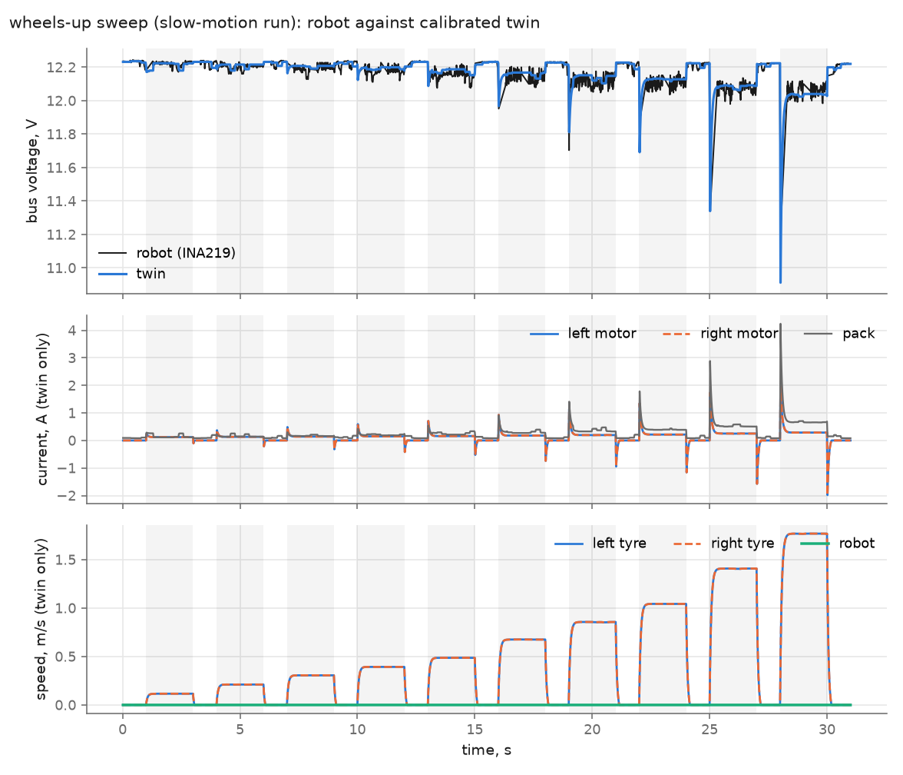
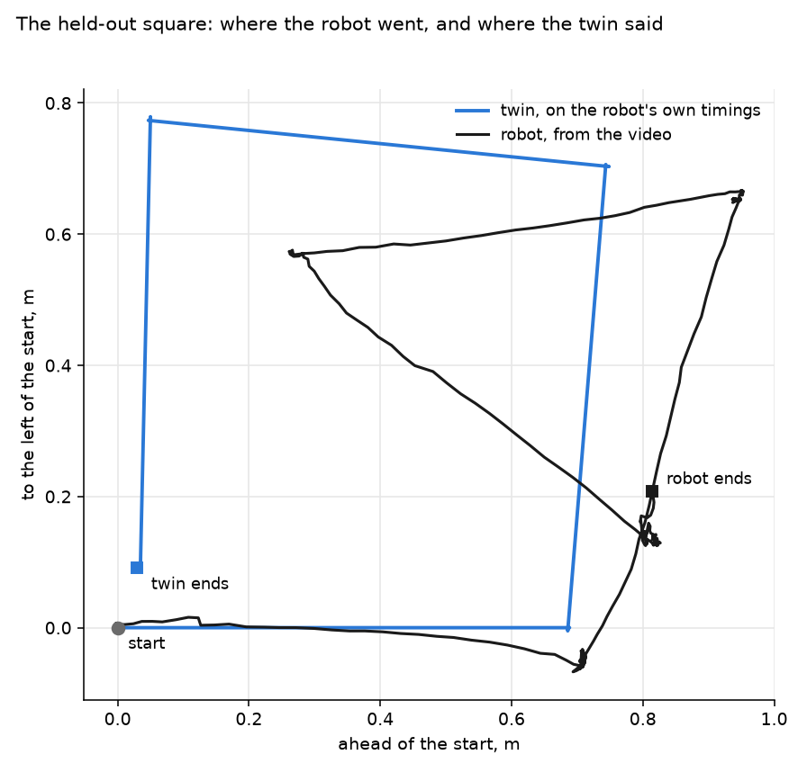
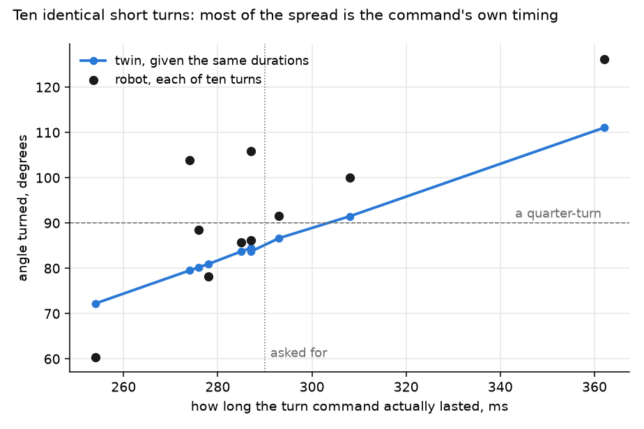
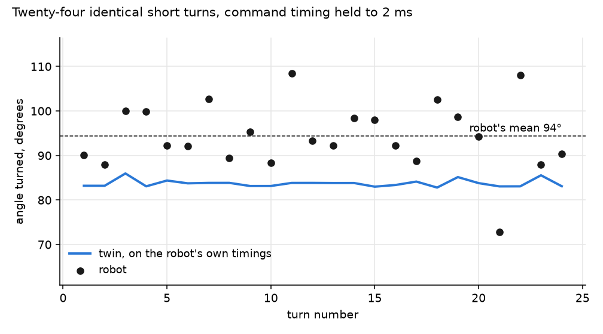
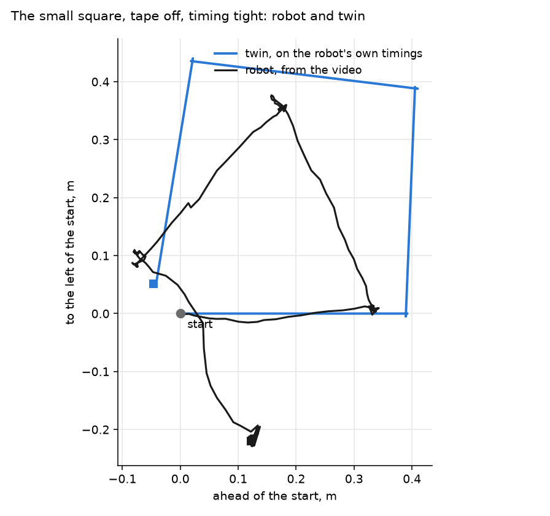

# Results: the twin against the real JetBot

Session `2026-10-04`, robot at 192.168.1.109. Logs are in
[data/real/2026-10-04/](../data/real/2026-10-04/), figures in
[results/2026-10-04/](../results/2026-10-04/). Reproduce with:

```bash
python -m jetbot_twin compare --session 2026-10-04               # as designed
python -m jetbot_twin calibrate --session 2026-10-04
python -m jetbot_twin --calibrated compare --session 2026-10-04
```

**Done so far:** the two stationary experiments, the driver-chip test, the
wheels-up sweep, the stall, the straight run and spin on the floor, the
held-out square, and its corner repeated ten times and then twenty-four.

This page is robot 1. A second robot of the same model was calibrated
separately on 2026-10-22 ([data/real/robot2-2026-10-22/NOTES.md](../data/real/robot2-2026-10-22/NOTES.md))
and driven straight 50 times against a test plan fixed beforehand
([results/robot2/RESULTS.md](../results/robot2/RESULTS.md)).

## What the probe found

| | |
|---|---|
| Jetson | Nano developer kit, JetPack 4.5 (L4T R32.5), Python 3.6.9 |
| I²C devices | 0x3C OLED, 0x41 INA219, 0x60 PCA9685 (0x70 is its all-call) |
| Battery monitor | INA219, so this is the later board revision |
| PCA9685 | asleep, prescaler at its power-on default: nothing had touched the motors since boot |
| Pack | **10.27 V at rest: about 13 % charged** |
| Jetson software | the `jetbot` package is not installed on the host (the image keeps it in Docker), and there is no Python I²C library |

The addresses match the schematic's strapping. The last row changed the agent:
it now talks to `/dev/i2c-1` directly when no I²C library is present. The
Jetson's own power monitor is readable only by root on this image, so its
files were made world-readable for the session (`chmod a+r`, undone by a
reboot).

## Experiment 1 and 2: rest, and a known load step

The Jetson's CPUs were loaded for 20 s. The Jetson measured its own draw rising
from 1.12 W to 5.03 W.



| | Robot | Twin as designed | Twin calibrated |
|---|---|---|---|
| Bus voltage lost to the load step | 266 mV | about 150 mV | 266 mV (fitted) |
| Bus voltage error over the run, RMS | | 80 mV | 30 mV |
| 5 V at the Jetson, idle | 4.96 V | 5.118 V | 4.95 V |
| 5 V at the Jetson, loaded | **4.50 V** | 5.118 V | 4.49 V |
| 5 V error over the run, RMS | | 453 mV | 34 mV |
| Jetson idle power | 1.1 W | 2.5 W (assumed) | taken from the robot |

The RMS figures for the calibrated twin are about the size of the bus
reading's own scatter at rest (23 mV), so on this experiment the twin is as
close as the sensor can show. That is one experiment and two fitted numbers;
it says the pack and rail models have the right form, not that the twin is
validated.

A fault in the agent, found on 2026-10-22: when the CPU-load processes
were stopped, they inherited the agent's stop handler and talked to the
PCA9685 over the shared I2C file, which redirected the main process's
battery readings to the PCA9685's registers. In this run it cost 23 samples
(30.16 to 30.44 s, reading 0 or 4.096 V). Both fits above use only readings
before 29.8 s, so they stand. The agent is fixed.

### Finding 1: the Jetson's 5 V sags to 4.5 V under load

The twin, built from the schematic, held the Jetson's supply at 5.118 V
whatever the load. The robot's does not: it falls 0.46 V for 0.89 A more
current. That is **0.55 Ω between the regulator and the point where the
Jetson measures its supply**: header pins, carrier traces and the carrier's
input switch, none of which is on the expansion board's schematic.

4.50 V is below the 4.75 V the Jetson Nano is specified for, with only the
CPUs loaded, no GPU work and no motors running. The check that reported "the
Jetson is safe in every scenario" was wrong, and it was wrong because of
something the twin did not contain. `r_5v_path` is now a parameter of the
model; `python -m jetbot_twin --calibrated check` shows the consequence.

Caveat: this rests on the Jetson's own INA3221 reading of its input voltage,
which I have not checked against a multimeter. A meter on the 40-pin header's
5 V pin under load would confirm it and would show how much of the drop is
before the header and how much after.

### Finding 2: the pack's resistance is about twice what was assumed

Fitted `cell_r0` is 0.125 Ω against an assumed 0.060 Ω, which puts the whole
path from cells to rail at about 0.55 Ω instead of 0.35 Ω. Two things to keep
in mind: the pack was nearly empty, and cells have more resistance when empty;
and the fit cannot separate the cells from the holder contacts. Repeat this on
a full pack before using the number for anything.

### Finding 3: the Jetson idles at 1.1 W, not 2.5 W

With no desktop session active and nothing running. The assumed figure was
pessimistic by more than half.

## Which driver chip: the TB6612FNG

Without opening the robot. The two possible chips are wired to different
PCA9685 channels, so `robot/agent.py identify` drives one set at a time
(wheels off the ground, one second each at half command) and watches the
battery rail:

| Channels driven | Rail dipped by |
|---|---|
| 0–3 only (DRV8870 inputs) | 0 mV |
| 8–13 only (TB6612FNG pins) | 204 mV |

So this board has the TB6612FNG, and `board` in `hardware.py` is now
`"tb6612"`. Of the two sets of predictions made beforehand, the ones that
apply are the TB6612FNG ones: slow decay, a nearly straight speed-against-command
line starting at about 0.1, and braking when the command returns to zero. The
wheels-up sweep will test those.

This corrects a guess of mine: I had taken the INA219 to mean the later,
DRV8870 board. It does not.

It also exposed a bug in the agent, which had never driven a real PCA9685:
it sent each PWM setting as one four-byte write, which the chip only spreads
over four registers when its auto-increment bit is set. The first run of this
test therefore moved nothing. The agent now writes one register at a time, as
the Adafruit library does, and reads one back to confirm.

## Experiment 3: the wheels-up sweep (pack charged, 12.2 V)

Ten commands from 0.1 to 1.0, two seconds each, wheels in the air. Run twice.
The second run was filmed in slow motion with a strip of tape on the hub, and
`tools/wheel_tape.py` reads the wheel's angle from the tape in every frame.
The true frame rate, 240.3 fps, comes from the holds themselves, which start
exactly 3 s apart. Nothing is aliased, and speed within a hold is steady to
4–10 rpm.



| Command | Robot, rpm | Twin as designed | Twin calibrated |
|---|---|---|---|
| 0.10 | 43 | 30 | 34 |
| 0.15 | 71 | 56 | 62 |
| 0.20 | 99 | 83 | 90 |
| 0.25 | 125 | 107 | 115 |
| 0.30 | 157 | 133 | 143 |
| 0.40 | 213 | 187 | 198 |
| 0.50 | 268 | 238 | 252 |
| 0.60 | 319 | 290 | 307 |
| 0.80 | 421 | 394 | 414 |
| 1.00 | 484 | 496 | 519 |
| error, rms | | 22 rpm (14 %) | 16 rpm (8 %) |

"As designed" is the twin with the motors as originally assumed and only the
pack fitted. "Calibrated" has the motor's speed constant, friction and the
split between constant and speed-dependent friction fitted to this table.

`tools/wheel_tape.py` now takes the median step from frame to frame instead
of a straight-line fit through the angle, so a misread frame cannot add or
drop a turn (it did on robot 2's slow-motion video). It reproduces the robot
column above to 1 to 3 %.

**The predictions held.** Against what was recorded beforehand for the
TB6612FNG ([predictions.txt](../results/predictions.txt)):

| | Predicted, 5–95 % | Measured |
|---|---|---|
| Lowest command that turns a free wheel | 0.10 | 0.10 |
| Free wheel at 0.5 | 199 – 284 rpm | 268 rpm |
| Free wheel at 1.0 | 413 – 596 rpm | 484 rpm |
| Shape | a straight line from 0.1 | a straight line from 0.1 to 0.8 |
| When the command returns to zero | brakes | stops in 0.09–0.20 s |

**The motors are 6 V units running about 6 % fast.** The fitted speed
constant is 255 rpm at 6 V against Waveshare's "240 RPM". At a command of 1.0
they are at twice their rated voltage.

**The dynamics agree without being fitted.** At a command of 0.5 the wheel
reaches 63 % of its speed in 83 ms and stops in 162 ms; the twin gives 80 ms
and 140 ms. Nothing was adjusted to get those: they follow from the assumed
rotor inertia and the braking the driver chip does.

**What the twin still gets wrong.** After calibration it is 7–17 rpm low from
0.1 to 0.8 and 35 rpm high at 1.0. The cause is one feature of the real motor:
its speed stops rising in proportion at the top. From 0.6 to 0.8 it gains
102 rpm; from 0.8 to 1.0, 63, where a straight line would give about 105. And
at 1.0 the robot draws *less* current than the twin (156 mV of sag against
178), not more. Slower and drawing less means the motor is seeing less voltage
than the twin thinks, or its back-EMF constant is not constant. I tried adding
a loss that grows with the square of speed (`motor_drag2`); it did not help,
because it would raise the current, which is already too high. This is
unexplained. Holds at 0.85, 0.9 and 0.95 would show whether the bend is
gradual or sudden, which would narrow it down.

**Two runs, and the floor they set.** The voltage dips in the two runs differ
by 24 mV rms, hold for hold. Much of that is the Jetson's own draw wandering.
The calibrated twin's dips differ from the robot's by 21 mV rms: as close as
the robot is to itself.

**The first run, at 30 fps with no tape**, is in `run1/`. It had to be read
from the hub's eight identical holes, known only modulo 225 rpm, and came out
about 5 % low. The motor's pitch on its soundtrack, taken as rotor speed and
divided by the 48:1 gearing, was within 2 % of the slow-motion figures from
0.25 up, which also confirms the gear ratio. The soundtrack puts the PWM at
about 1560 Hz rather than the 1526 Hz the chip's arithmetic gives: its
oscillator runs about 2 % fast, within tolerance.

## Experiment 4: stall

Both wheels held, command 0.5 for 1.5 s.

| | Robot | Twin as designed | Twin calibrated |
|---|---|---|---|
| Bus voltage lost | 486 mV | 443 mV | 487 mV (fitted) |
| Stall current, each motor | not measurable | 1.31 A | 1.48 A |

Fitting the winding resistance to that dip gives 3.45 ohm against an assumed
4.0. It is inferred through the pack resistance, not metered, so an error in
one is an error in the other.

## The pack again, charged

The load step was repeated on the charged pack. `cell_r0` came out at
0.0575 ohm, against 0.125 on the flat pack and 0.060 assumed. So the original
assumption was right for a charged pack, and the pack's resistance roughly
doubles as it empties. The twin has one number for it and no dependence on
charge: a known gap. The 5 V path resistance came out the same both times
(0.49 and 0.55 ohm), and the Jetson's supply again fell to 4.57 V under load.

## An unexplained power loss

At about 14:15 the robot lost power abruptly: no shutdown messages in its
log, a few minutes after the driver-chip test had finished and released the
motors, idle, with the charger delivering 1.8 A and the pack at 11.3 V. Not
a low-battery cut-out at that voltage. Candidates are a cell or the switch
losing contact while the robot was being handled, or the protection chip
tripping; the logs cannot distinguish them. It has not recurred.

## Experiment 5: straight, on the floor

Command 0.5 for 2 s on 50 cm tiles, pack at 11.82 V. The twin's prediction was
saved before the run ([prediction_straight.json](../results/2026-10-04/prediction_straight.json)).
At that point the twin had been fitted only with the wheels in the air: its
floor friction was still as assumed.

| | Twin predicted | Robot | After the floor fit |
|---|---|---|---|
| Distance | 1.47 m | 1.43 m | 1.43 m |
| Bus voltage lost | 103 mV | 139 mV | 113 mV |
| Sideways drift | 0 | 5–10 cm left | 0 |
| Heading change | 0 | about 10° | 0 |

Distance was predicted to within 3 %. The drift and the turn are outside the
twin: its two motors are identical, and it knows nothing of tile joints. The
robot's own figures for them are rough (it may not have started square).

## Experiment 6: spin, on the floor

Command ∓0.4 for 2 s, run three times; the third, on a single tile clear of
the joints, was filmed from above in slow motion. `tools/spin_video.py` reads
the heading in every frame as the direction from the middle of the green
chassis to its lit blue display: a marker with no symmetry. Scatter at rest
is under 1°. Prediction saved beforehand:
[prediction_spin.json](../results/2026-10-04/prediction_spin.json).

| | Twin predicted | Robot | After the floor fit |
|---|---|---|---|
| Total rotation | 1095° (3.04 turns) | 1033° (2.87 turns) | 1025° |
| Steady yaw rate | 556°/s | 504°/s | |
| Ended this far from its start | 1 cm | 1 cm | |
| Direction | counter-clockwise | counter-clockwise | |
| Bus voltage lost | 68 mV | 108 mV | 82 mV |

Rotation was predicted to within 6 %, on a quantity the twin's own error
bars had put anywhere from 950° to 1310°.

Getting this number took three attempts at the method, which is worth
recording because the first two gave confident wrong answers (0.75 and 1.8
turns). Following the long axis of the chassis is ambiguous by a half-turn
and flickers; matching each frame's picture to the last is thrown by the
robot's shadow turning with it. An unambiguous marker was the fix, as tape on
the tyre was for the wheel.

**What both floor runs say.** The twin was a few percent optimistic both
times, and both times the robot drew more current than the twin expected. That
is one thing, not two: more drag on the floor than assumed. Fitting the two
drag numbers the twin has (`gear_eff` 0.65 → 0.514, `mu_caster` 0.25 → 0.324)
brings distance and rotation to within 1 %. The voltage dips come closer but
stay about 25 mV low, so there is still current going somewhere the twin does
not account for. And `gear_eff` has moved further than a gearbox's efficiency
plausibly would: it is absorbing drag that belongs to something the twin has
no term for.

## Experiment 7: the square (held out)

Nothing was fitted to this. Four sides at 0.5 for 1.0 s, each followed by a
left turn at ∓0.3 for 0.29 s, which is a quarter-turn in the calibrated twin.
Filmed from above; `tools/path_video.py` uses the 50 cm tile joints as its
ruler and traces the robot as a shape against the floor.



| | Twin | Robot |
|---|---|---|
| The four sides | 0.69, 0.71, 0.71, 0.69 m | 0.70, 0.72, 0.69, 0.69 m |
| Peak speed on a side | 0.76 m/s | 0.81–0.85 m/s |
| The corners | 85°, 89°, 94° | 78°, 116°, 133° |
| Ends this far from its start | 0.10 m | 0.84 m |

**The twin got the straights and missed the turns.** Every side is within
3 cm. The corners are out by 7°, 27° and 39°, and that is the whole of the
0.8 m by which the twin's end point misses.

The twin is the model replayed on the timings the robot actually achieved
(the turns ran 0.285, 0.293 and 0.311 s, not 0.290: writing a command over
I²C takes about 30 ms). That accounts for the twin's own corners differing,
85° to 94°. It does not account for the robot's, which differ four times as
much.

**Why the turns, when the spin was right to 6 %?** The spin ran for two
seconds, nearly all of it at a steady rate, and steady rates are what the twin
was calibrated on. A 0.29 s turn from rest never reaches a steady rate: it is
all breakaway and spin-up, on a tiled floor, with two wheels that are not
identical. The twin has one breakaway friction figure, the same for both
wheels, which nobody has measured (`motor_friction_static_ratio` is still an
assumption), and no floor texture. That the robot's corners grow through the
run, 78° then 116° then 133°, says it is not just scatter; I do not know what
is growing.

**What would settle it.** Ten repeats of the 0.29 s turn alone, filmed close
from above and measured with `tools/spin_video.py`: the spread says how
repeatable a short turn is on this floor, and the mean against the twin's 90°
says whether the twin is biased or merely blind to something random. If the
spread is as wide as these three corners, no model will predict a single
open-loop square on this robot, and the honest claim for the twin is the
distribution, not the path.

**A correction made on the way.** As first defined, the square's corners were
0.3 s at ∓0.5, which the twin showed to be nearer a half-turn: the robot would
have shuttled back and forth. The corners were retimed to a quarter-turn
before the run. The first attempt at the run was also discarded: the agent
timed the motors and read the sensors in one loop, so a slow sensor read
could stretch a turn. The motors now have their own clock, and the log
records when each command was sent.

**Tracking, again.** The first path this tool produced had one side 0.91 m
long at an impossible 1.18 m/s. The floor grid had been allowed to follow the
tile joints as the phone drifted, and one of them had walked onto the edge of
a shadow. With the grid held to where joints can be, all four sides came out
alike. The robot's heading from its outline is not reported: an outline is
ambiguous by a half-turn and changes shape with perspective. The corners above
come from the direction of travel along each side.

## Experiment 8: ten short turns

The square's corner on its own, ten times: ∓0.3 for 0.29 s, then a rest.
Filmed from above at 30 fps and measured with the marker method of
`tools/spin_video.py` (chassis centre to blue display). Each turn's angle is
the heading 0.75–1.15 s after its command was sent, less the heading just
before, using the robot's own record of when each command went out.



| | |
|---|---|
| The ten turns | 104, 92, 88, 78, 126, 86, 100, 60, 106, 86° |
| Mean, spread | 92.7°, standard deviation 17.7° (19 %) |
| How long each command really lasted | 254 to 362 ms, for 290 asked |
| Twin, given those durations | 80, 87, 80, 81, 111, 84, 91, 72, 84, 84° |
| Robot minus twin | mean +7°, standard deviation 11° |

**Most of the spread is not the robot. It is the command.** The turn was
asked to last 290 ms and lasted anywhere from 254 to 362. Angle follows
duration closely (correlation 0.82), at 5° for every 10 ms. Sending a motor
command is fourteen register writes over I²C from Python on the Jetson; that
takes tens of milliseconds and is not the same every time. The stock `jetbot`
library sends commands the same way, so this is how the robot behaves in
ordinary use, not a quirk of this test.

**What is left is about 11° of real scatter per turn**, and a twin that is
7° low on average. So for a quarter-turn on this floor: the twin is biased by
about 8 %, and the robot repeats itself to about ±11° even when the timing is
accounted for.

**Is the twin too sluggish in a short turn? Not shown.** The robot gains
505° of turn per extra second of command and the twin 358°, and I first read
that as the twin's inertia about the vertical axis being too large. Two
checks say otherwise. The slope rests on ten points, eight of them bunched
within 35 ms of each other: its uncertainty is about ±125°/s, so 505 against
358 is barely more than one standard error. And fitting the inertia directly
(`yaw_inertia_scale`) ran it to its lower bound, a sixth of the estimate,
while moving the twin's slope from 359 to 364°/s and leaving the scatter
where it was. A parameter that hits its bound without explaining the data is
the wrong parameter. The inertia is left as estimated. The 7° mean bias is
about two standard errors: suggestive, no more.

**What this says about the square.** Its corners were 78°, 116° and 133°
against the twin's 85°, 89° and 94°. A spread of ±11° with a +7° bias covers
the first of those and not the other two, so the square had something more
going on than these in-place turns show: the robot arrives at each corner
having just braked from 0.8 m/s, which these turns from rest do not test.

## The command timing, afterwards

The agent was reworked so that the writes which actually start and stop the
wheels land on time: the direction pins are sent 12 ms early (they move
nothing by themselves), the bus is taken 4 ms early, and only the bytes that
changed are written. Timed on the robot with every write redirected to an
unconnected channel, so that nothing moved:

| | Asked | Before | After |
|---|---|---|---|
| Turn duration, 30 dry turns | 290 ms | 254 – 362 ms, sd about 29 | 253 – 305 ms, sd 9 |

Three times tighter. A few turns in thirty are still 20–50 ms out. The likely
cause is the status display, which shares the I²C bus: a refresh of it holds
the bus for tens of milliseconds, and a motor command has to wait. That has
not been confirmed; pausing the display's service during a run would test it.

## Experiment 9: twenty-four short turns, with the timing fixed

The same turn, 24 times, after the agent was reworked. Every command lasted
between 288 and 297 ms (standard deviation 2.2 ms), so what varies now is the
robot.



| | Robot | Twin |
|---|---|---|
| Mean turn | 94.3° | 83.7° |
| Spread (standard deviation) | 7.6° (8 %) | 0.8° |
| Range | 73° to 108° | |
| Trend through the run | none (−0.08° per turn, ±0.23) | |
| Drift of the robot's position | 3 cm by the end | |

**The bias is real: the robot turns 10.6° further than the twin, 12.6 % more.**
That is 6.9 standard errors over 24 turns. In experiment 8 it was two
standard errors and not to be relied on; with the timing held still it is not
in doubt.

**The robot repeats a short turn to about ±8°.** With timing no longer
contributing, this is the robot and the floor. It is a floor under any model:
a twin that was otherwise perfect would still miss a single quarter-turn by
this much, and four of them in a square by roughly twice it.

**No single number in the twin explains the bias.** Each plausible one was
fitted to these 24 turns on its own, then checked against the spin and the
straight run, which it must not break:

| Parameter moved | To match the turns it goes | And then |
|---|---|---|
| Breakaway friction | nowhere: it has no effect | |
| Rotor inertia | to its limit, a third of the estimate | still 2.5° short; and the wheels-up spin-up time, which matched at 80 ms against 83, would not |
| Inertia about the vertical axis | to its limit, 0.3 of the estimate | still 6° short |
| Caster friction | 0.324 → 0.179 | matches the turns exactly, but the 2 s spin goes to 1084° (robot 1033°) and the straight run to 1.48 m (robot 1.43 m) |

So the caster's drag has to be lower in the first third of a second of a turn
than it is in a sustained spin, and the twin has one caster friction for
both. That is a statement about the model's form, not its numbers: a ball
caster that rolls freely at first and only starts to drag once it is being
pushed sideways continuously would do it. That is a hypothesis; nothing here
tests it directly. `hardware.py` is unchanged.

## A confound, found late: tape on the left tyre

A strip of tape put on the left tyre for the slow-motion wheel video stayed
on, covering part of the tread, through every floor test above: the straight
run, the spin, the first square and both sets of short turns. Their logs and
videos are in `data/real/2026-10-04/tape_on/`. The straight run and the spin
were repeated without it, and a square was run fresh.

| | Tape on | Tape off | Twin for the tape-off run |
|---|---|---|---|
| Straight: distance | 1.43 m | 1.47 m | 1.45 m |
| Straight: sideways drift | 5–10 cm to the left | more than 25 cm to the right | 0 |
| Spin: rotation | 1033° | 1037° | 1043° |
| Spin: steady rate | 504°/s | 529°/s | |

**The tape barely touched distance or rotation**, so the floor-drag numbers
fitted to the tape-on runs stand: with the tape off the twin is within 2 cm
on the straight and 6° on the spin.

**It changed the drift completely, and that exposes something real.** With
the tape on, the robot veered a little left; without it, 25 cm right in
1.47 m. If that path is an arc, its radius is about 4.4 m and the two wheels
differ in speed by about 2.6 %. The tape had been slowing the left wheel
enough to hide a right wheel that is the slower of the two. The twin's motors
are identical, so it predicts no drift at all. One number would add it (the
right motor about 2.6 % down on the left); it is not added yet because it
rests on one run.

## Experiment 10: a smaller square, tape off, timing tight

Sides of 0.6 s instead of 1.0 s, to fit in a 2 × 2 block of tiles under a
phone held still. Corners as before. Held out. All four turns lasted 285 to
292 ms.



| | Twin | Robot |
|---|---|---|
| The four sides | 0.39, 0.40, 0.39, 0.40 m | 0.33, 0.39, 0.37, 0.39 m |
| The corners | 88°, 85°, 88° | 113°, 112°, 75° |
| Ends this far from its start | 0.07 m | 0.25 m |
| Twin's end to robot's end | | 0.32 m |

The same verdict as the larger square, now without the tape and without the
timing error to blame: **the sides are right and the corners are not.**

Putting the two squares' corners together, six of them: 78°, 116°, 133°,
113°, 112°, 75°. Mean 105°, standard deviation 23°. The same turn made from
rest, 24 times, gave 94° with a standard deviation of 8°. So a corner taken
straight after a side is **three times as variable** as the same turn from a
standstill, and probably larger on average. The command is identical; what
differs is the state the robot is in when it arrives.

What that state is, I have not established. The two candidates the twin has
no model of are gearbox backlash (after driving forward both gear trains are
loaded forward; a left turn asks the left one to reverse through its slack
first, while the right one pushes at once) and whatever the robot is still
doing 0.6 s after braking from 0.7 m/s. A turn after a longer pause, and a
turn to the right as well as the left, would separate them.

**What the twin can and cannot be used for, on this evidence.** It predicts
how far the robot goes and how fast it turns in steady motion to a few
percent, and it did so before being fitted to the floor. It does not predict
where an open-loop path with short turns ends, and no setting of its present
numbers would make it: the robot itself does not repeat those corners.

## What changed in the twin as a result

| | Was | Now | From |
|---|---|---|---|
| `board` | drv8870 (a guess) | tb6612 | driver-chip test |
| `r_5v_path` | absent | 0.49 ohm | load step |
| `cell_r0` | 0.060 assumed | 0.0575 | load step, charged |
| `motor_v_rated` | 6 V assumed | confirmed | wheels-up sweep |
| `motor_rpm_noload` | 240 rpm | 255 rpm | wheels-up sweep |
| `motor_i_noload` | 0.16 A | 0.197 A | wheels-up sweep |
| `motor_coulomb_fraction` | 0.7 | 0.56 | wheels-up sweep |
| `motor_r` | 4.0 ohm | 3.45 ohm | stall |
| `jetson_p_idle` | 2.5 W | 1.15 W | rest |
| `wheel_radius` | 32.5 mm | 31.5 mm | ruler |
| `gear_eff` | 0.65 | 0.514 | straight and spin |
| `mu_caster` | 0.25 | 0.324 | spin |

## Still to do

Why a corner after a side differs from the same turn from rest: turns after a
longer pause, and to the right as well as the left. The left/right motor
mismatch added to the twin (robot 2's 50 straights show the drift is not one
steady mismatch: most runs go nearly straight and a fifth swerve hard left).
A caster model that rolls along its direction of travel and scrubs sideways
(robot 2's results show one drag number cannot do both). The short turns
repeated without the tape. `step_response`. Extra holds near full command, to look at the bend. And the hand
measurements: the robot's mass, the wheel's diameter, the cells'
label.
